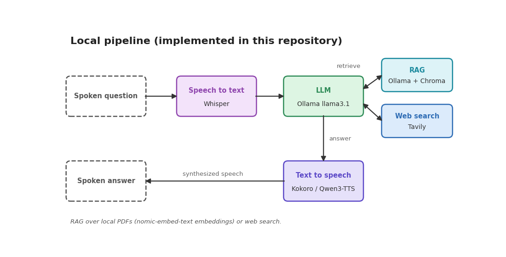
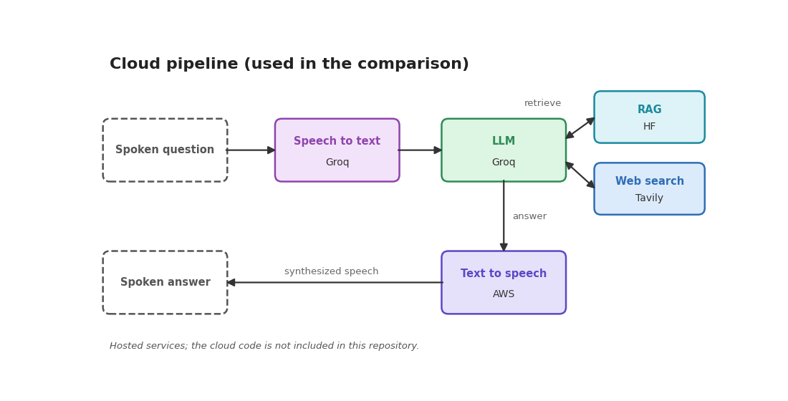
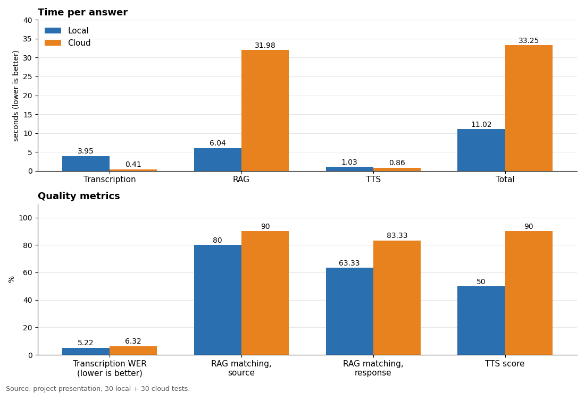

# Voice Assistant with Local and Cloud Pipelines (Whisper, RAG, TTS)

Developed together with [Miquel Gómez Corral](https://github.com/MiquelGomezCorral).

A voice assistant that takes a spoken question, transcribes it, answers using a local document library (RAG) or web search, and replies by voice. We built two variants and compared them: a fully **local** one (this repository) and a **cloud** one based on hosted services. The cloud code is not included here.

**Headline result:** the local pipeline answered in 11.02 s on average versus 33.25 s for the cloud one. The best combination found was cloud speech-to-text + local RAG + cloud TTS, at about 7.5 s per answer.

      

<div align="center">
  <a href="https://www.youtube.com/watch?v=qFbEtfm45SM">
    
  </a>
  <br>
  <em>Click to watch the demo</em>
</div>

## Architecture

<p align="center"></p>

<p align="center"></p>

## Results

All figures below are those reported in the project presentation: 60 tests (30 local, 30 cloud). The hardware and the test set (questions and PDFs) are not stated, so read them as indicative of this project, not as a general benchmark. In the local pipeline each model has to be loaded into memory, which is reflected in its times. TTS score and RAG matching are metrics reported in the presentation.

<p align="center"></p>

<details>
<summary>Show the underlying table</summary>

| Metric | Local | Cloud |
|---|---|---|
| Transcription time (s) | 3.95 | 0.41 |
| RAG time (s) | 6.04 | 31.98 |
| TTS time (s) | 1.03 | 0.86 |
| Total time (s) | 11.02 | 33.25 |
| Transcription WER (%) | 5.22 | 6.32 |
| RAG matching, source (%) | 80 | 90 |
| RAG matching, response (%) | 63.33 | 83.33 |
| TTS score (%) | 50 | 90 |

</details>

**Key findings**

- RAG dominates the cloud total: 31.98 s of 33.25 s (about 96%), against 6.04 s locally, roughly 5.3 times slower.
- Overall, the local pipeline is about 3 times faster (11.02 s vs 33.25 s).
- Cloud transcription is faster (0.41 s vs 3.95 s), but its WER is slightly higher (6.32% vs 5.22%).
- Cloud scores higher on the quality metrics: RAG response matching 83.33% vs 63.33%, source matching 90% vs 80%, TTS score 90% vs 50%.
- Best combination found: cloud speech-to-text + local RAG + cloud TTS, at about 7.5 s per answer (the figure stated in the presentation).

## Setup

Prerequisites: Python 3.12, [Ollama](https://ollama.com) running locally with the models set in `app/src/config/config.py` (`llama3.1` for answers, `nomic-embed-text` for embeddings), SoX (only for Qwen3-TTS), and a Tavily API key for web search. Whisper uses the `turbo` model by default.

```bash
python3.12 -m venv venv && source venv/bin/activate
pip install uv
uv pip install -r requirements.txt
pip install -e app/
sudo apt install sox -y          # audio processing (Qwen3-TTS)
ollama pull llama3.1 && ollama pull nomic-embed-text
mkdir -p data/audios data/pdfs
cp .env.example .env             # add your TAVILY_API_KEY
```

`qwen-tts` is imported by the package even when you use Kokoro, so it is required. `requirements-original.txt` keeps the exact pins used before the cleanup.

Put the PDFs for the knowledge base in `data/pdfs/`; the index is built on first run in `data/db_data/`. Models and voices are set in `app/src/config/config.py`.

## Usage

```bash
cd app
python main.py full -a path/to/audio.wav   # command line
streamlit run app.py                       # web UI
```

### Text to speech

- **Kokoro** (default, `hexgrad/Kokoro-82M`): fast and light.
- **Qwen3-TTS** ([Qwen3-TTS-12Hz-1.7B-CustomVoice](https://huggingface.co/Qwen/Qwen3-TTS-12Hz-1.7B-CustomVoice)): multilingual (Chinese, English, Japanese, Korean, German, French, Russian, Portuguese, Spanish, Italian) with several voices. Requires `pip install qwen-tts` and `transformers==4.57.3`; `flash-attn` is optional.

## Repository layout

```
app/
  main.py, app.py   CLI and Streamlit UI
  src/config/       configuration
  src/models/       whisper, rag, kokoro, qwen3
assets/             diagrams, results chart, thumbnail
data/               created by you: audios/, pdfs/, db_data/ (index)
.env.example        template for TAVILY_API_KEY
requirements.txt
```
